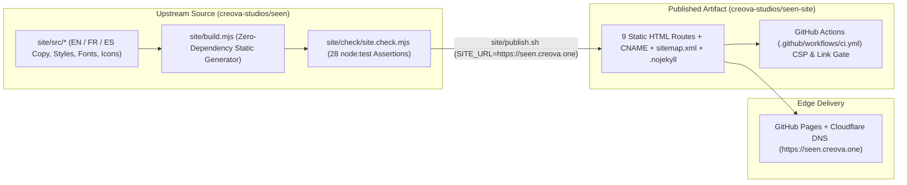

# SEEN — Static Production Web Artifact (`seen.creova.one`)

[](https://github.com/creova-studios/seen-site/actions/workflows/ci.yml)
[](LICENSE)

`creova-studios/seen-site` hosts the pre-built, zero-dependency multilingual (`EN` / `FR` / `ES`) static web artifact served via GitHub Pages at **[https://seen.creova.one](https://seen.creova.one)**.

> [!IMPORTANT]
> **Artifact Repository Notice:** Do not hand-edit generated HTML or CSS in this repository. All source templates, localized copy (`EN`/`FR`/`ES`), self-hosted font assets, and the 28-assertion `node:test` verification suite live upstream in **[`creova-studios/seen`](https://github.com/creova-studios/seen)** under `site/`.

---

## Implementation & Surface Status

| Capability / Surface | Path in Repo | Status |
| --- | --- | --- |
| **Trilingual Landing Pages (`EN` / `FR` / `ES`)** | `index.html`, `fr/index.html`, `es/index.html` | **Implemented & Deployed (`https://seen.creova.one`)** |
| **Trilingual Terms & Privacy Pages** | `terms/`, `privacy/`, `fr/{terms,privacy}/`, `es/{terms,privacy}/` | **Implemented & Deployed** |
| **Interactive "Make a SEEN" Story-Seed Preview** | `site.js` (client-only progressive enhancement, zero network/storage) | **Deterministic Client Preview** |
| **Strict `default-src 'none'` Content-Security-Policy** | Enforced in `<head>` across all 9 HTML routes + CI | **Implemented & Verified** |
| **SEEN Web Creator Studio & Native Mobile App** | Upstream [`creova-studios/seen`](https://github.com/creova-studios/seen) (`src/`, `mobile/`) | **Separate Product Repository** |

---

## Architecture & Deployment Provenance



### Rebuilding & Publishing from Upstream

From a clean checkout of [`creova-studios/seen`](https://github.com/creova-studios/seen):

```bash
cd site
SITE_URL=https://seen.creova.one node build.mjs
SITE_URL=https://seen.creova.one npm run check
SITE_URL=https://seen.creova.one bash publish.sh https://github.com/creova-studios/seen-site.git main
```

---

## Security & Privacy Posture

Every HTML document in this repository ships with a strict, fail-closed `Content-Security-Policy` and `Referrer-Policy`:

```html
<meta
  http-equiv="Content-Security-Policy"
  content="default-src 'none'; script-src 'self'; style-src 'self'; font-src 'self'; img-src 'self' data:; base-uri 'self'; form-action 'none'"
/>
<meta name="referrer" content="strict-origin-when-cross-origin" />
```

1. **Zero Third-Party Requests or Trackers:** `default-src 'none'` blocks all external scripts, stylesheets, iframes, form submissions, and `fetch`/`XHR` beacons. Fonts (`fonts/instrument-serif-*.woff2`) and imagery (`img/*`, `icons/*`) are 100% self-hosted.
2. **No Cookies or Browser Storage:** `site.js` operates purely on in-page DOM state and optional `navigator.clipboard.writeText` on explicit user click; no cookies, `localStorage`, or analytics identifiers exist.
3. **Automated Artifact Verification:** `.github/workflows/ci.yml` validates all 9 localized HTML routes, exact CSP & referrer tags, `CNAME` (`seen.creova.one`), `sitemap.xml` parity, and relative asset resolution on every pull request.

See [`SECURITY.md`](SECURITY.md) for vulnerability disclosure details.

---

## Local Preview & Verification

No `npm install` is required to preview or verify this repository locally.

### Serve Locally

```bash
# Option 1: Python built-in static server
python3 -m http.server 8080

# Option 2: Node one-shot static server
npx --yes serve . -l 8080
```

Then open `http://localhost:8080/` (English), `http://localhost:8080/fr/` (French), or `http://localhost:8080/es/` (Spanish).

---

## Directory Layout

```text
.
├── index.html              # English landing page
├── terms/index.html        # English terms of use
├── privacy/index.html      # English privacy policy
├── fr/                     # French landing, terms, and privacy pages
├── es/                     # Spanish landing, terms, and privacy pages
├── styles.css              # Compiled stylesheet (comments stripped at build time)
├── site.js                 # Progressive-enhancement script for "Make a SEEN"
├── fonts/                  # Self-hosted Instrument Serif WOFF2 + SIL OFL 1.1 license
├── icons/ & img/           # App icons, wordmark, and product preview imagery
├── CNAME                   # GitHub Pages custom domain (seen.creova.one)
├── robots.txt & sitemap.xml# Crawler policy and 9-URL multilingual sitemap
├── .nojekyll               # Disables Jekyll processing on GitHub Pages
├── .github/workflows/ci.yml# Automated HTML, CSP, link, and sitemap verification
├── SECURITY.md             # Static CSP posture & vulnerability reporting
└── LICENSE                 # CREOVA Studios Inc. proprietary license
```

---

## License

Copyright (c) 2026 **CREOVA Studios Inc.** All rights reserved. See [`LICENSE`](LICENSE) (self-hosted fonts under `fonts/` are licensed under the SIL Open Font License 1.1 in [`fonts/OFL.txt`](fonts/OFL.txt)).
